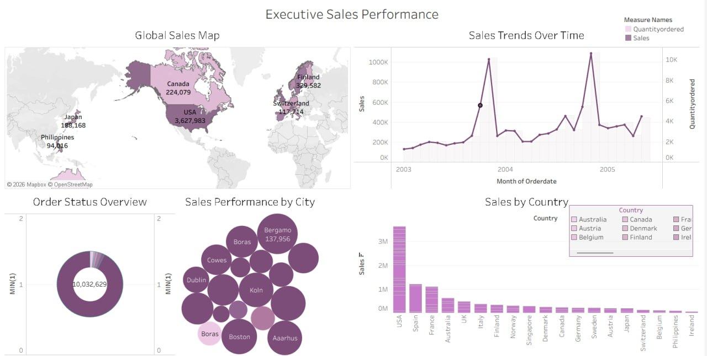
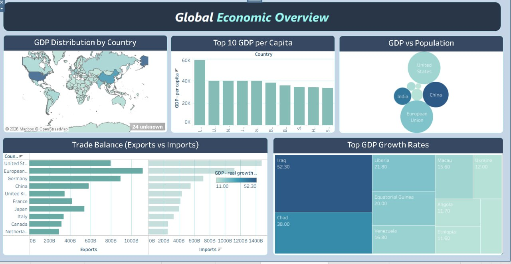
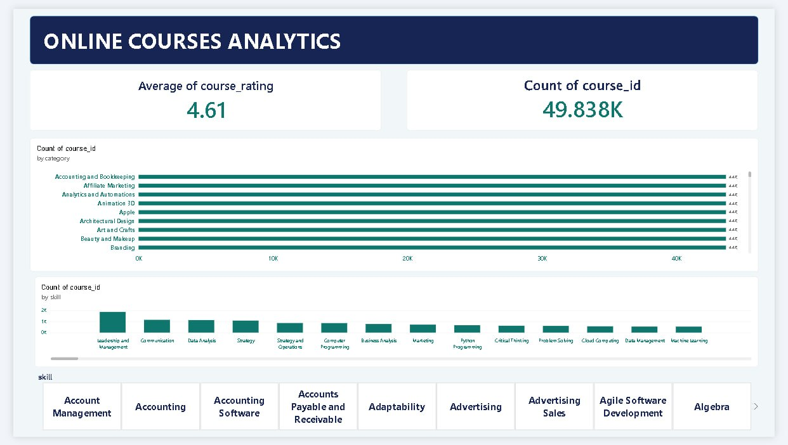
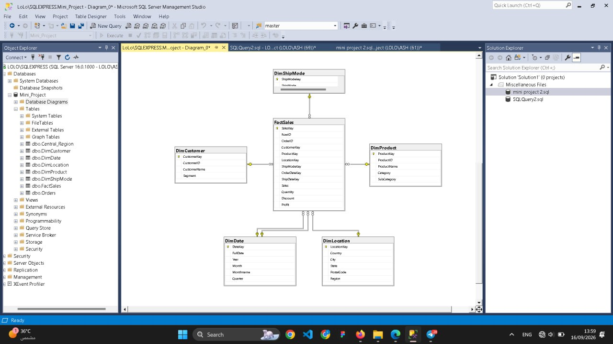
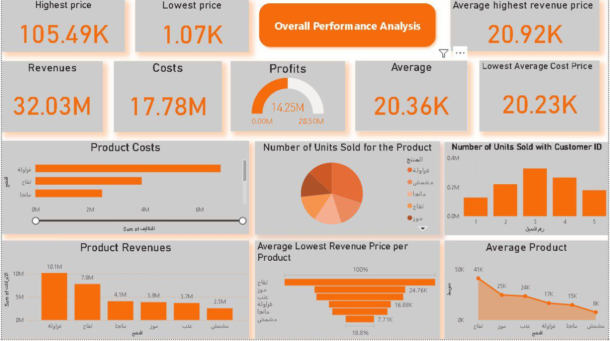
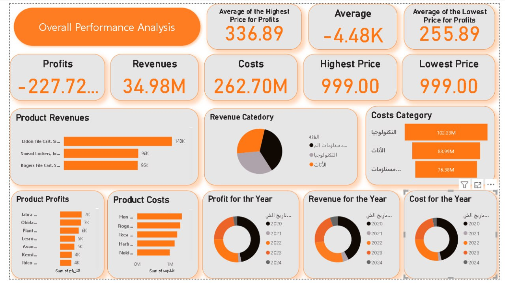
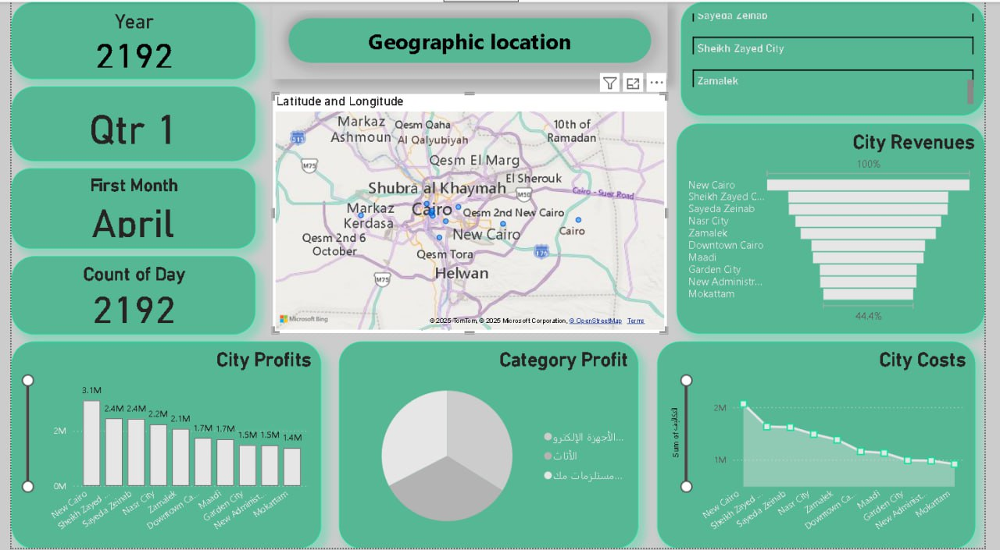
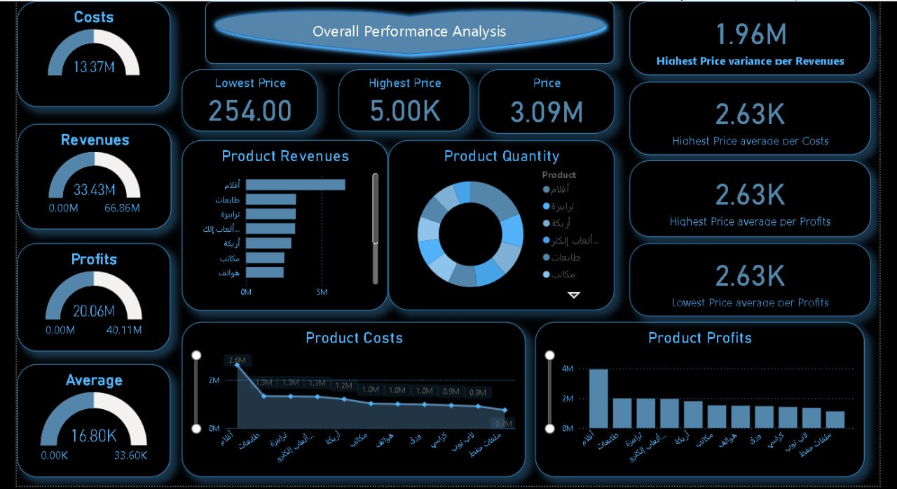

# Data Analytics Portfolio

Dashboards and data models built with **Power BI, Power Query, Tableau and SQL Server**, covering sales, finance, geographic and economic analysis.

## Tools
Power BI · Power Query · Tableau · SQL Server (SSMS)

---

## 1. Executive Sales Performance (Tableau)
Global sales map, sales trends over time, order status overview, and sales by city and country.

## 2. Global Economic Overview (Tableau)
GDP distribution by country, GDP per capita, GDP vs population, trade balance (exports vs imports), and top GDP growth rates.

## 3. Online Courses Analytics (Power BI)
Average course rating, number of courses by category and by skill, with a skill slicer.

## 4. Sales Data Warehouse (SQL Server)
Star schema design: a sales fact table (FactSales) connected to customer, product, date, location and ship-mode dimensions.

## 5. Costs, Revenues & Profits Dashboards (Power BI)
A series of dashboards analyzing costs, revenues and profits by product, category, city and year, including a geographic view.

---

## Contact
- LinkedIn: https://www.linkedin.com/in/shaimaa-mahmoud-4609892b9
- Mostaql: https://mostaql.com/u/shaimaa_S14
